# BÁO CÁO BÀI TẬP LỚN

## Học phần: Phân tích và thiết kế hướng đối tượng (OOAD)

## Đề tài: Hệ thống Quản lý sự cố CNTT và kho kinh nghiệm xử lý

| | |
|---|---|
| Nhóm | *(điền tên nhóm)* |
| Lớp | *(điền lớp)* |
| Thành viên | *(điền họ tên — MSV — nhiệm vụ, xem bảng phân công ở Phụ lục)* |
| Giảng viên hướng dẫn | *(điền tên GVHD)* |
| Ngày | *(điền ngày nộp)* |

---

### Ghi chú về đề tài

Đề tài "Quản lý sự cố CNTT" không nằm trong 10 đề tài gợi ý ở Mục 8 của hướng dẫn BTL, nhóm chọn theo diện
"đề xuất đề tài khác có độ phức tạp tương đương" (Mục 2 hướng dẫn). Đây **chính là bài toán nhóm đã phân
tích, thiết kế và cài đặt cho đồ án Java** (xem [README.md](README.md), [SO_DO_QUAN_HE.md](SO_DO_QUAN_HE.md)
và mã nguồn trong `src/`) — báo cáo này dùng lại đúng bài toán đó để trình bày quy trình OOAD: từ yêu cầu
nghiệp vụ → mô hình phân tích → mô hình thiết kế, đối chiếu lại với ứng dụng đã chạy được. Nhóm **cần xin
xác nhận của giảng viên** trước khi nộp chính thức.

### Ghi chú sử dụng công cụ AI (theo Mục 6 của hướng dẫn)

Bộ khung báo cáo này (cấu trúc chương, các sơ đồ UML vẽ bằng PlantUML trong `docs/uml/`, thẻ CRC, bảng test
case) được soạn với sự hỗ trợ của Claude (Anthropic), dựa trên việc đọc trực tiếp mã nguồn ứng dụng đã có (`src/main/java/...`) và
tài liệu `sql/`, `SO_DO_QUAN_HE.md` của chính dự án. **Đây là bản nháp có căn cứ, không phải bản hoàn
chỉnh**: nhóm bắt buộc phải tự đọc lại toàn bộ, chạy thử ứng dụng để kiểm chứng các sơ đồ tương tác, điều
chỉnh những chỗ chưa đúng ý đồ thiết kế ban đầu của nhóm, tự điền phần giả định/quyết định mang tính chủ
quan (ví dụ phần "điểm mơ hồ" ở Chương 2), và phải giải thích được mọi nội dung khi bảo vệ.

---

## Mục lục

1. [Bài toán và phân tích yêu cầu](#chương-1-bài-toán-và-phân-tích-yêu-cầu)
2. [Mô hình phân tích](#chương-2-mô-hình-phân-tích)
3. [Thiết kế hệ thống](#chương-3-thiết-kế-hệ-thống)
4. [Cài đặt và kiểm thử](#chương-4-cài-đặt-và-kiểm-thử)
5. [Kết luận](#kết-luận)
6. [Tài liệu tham khảo](#tài-liệu-tham-khảo)
7. [Phụ lục](#phụ-lục)

---

## CHƯƠNG 1. BÀI TOÁN VÀ PHÂN TÍCH YÊU CẦU

### 1.1. Giới thiệu bài toán, mục tiêu và phạm vi

Một trường đại học có nhiều phòng máy, phòng học và văn phòng, mỗi phòng có các thiết bị CNTT (máy tính,
máy chiếu, máy in, thiết bị mạng...). Sinh viên, giảng viên và cán bộ thường xuyên gặp sự cố liên quan đến
thiết bị, mạng, phần mềm hoặc tài khoản, và cần báo cho bộ phận CNTT xử lý. Hiện việc báo sự cố và theo dõi
xử lý còn thủ công (gọi điện, nhắn tin rời rạc), không có nơi tra cứu lại cách xử lý các sự cố tương tự đã
gặp trước đó.

**Mục tiêu hệ thống:**

- Cho người dùng (sinh viên/giảng viên/cán bộ) báo sự cố, theo dõi tiến độ xử lý, trao đổi với bộ phận
  CNTT và đánh giá mức hài lòng sau khi xong.
- Cho cán bộ CNTT tiếp nhận, xử lý, ghi nhận nguyên nhân/cách khắc phục, và tích lũy lại thành kho kinh
  nghiệm dùng chung.
- Cho cả hai bên tra cứu kho kinh nghiệm để tự xử lý các sự cố đã từng gặp, giảm tải cho bộ phận CNTT.
- Hỗ trợ cán bộ CNTT quản lý danh mục liên quan (phòng, thiết bị, loại sự cố, tài khoản người dùng) và xem
  thống kê tổng quan.

**Phạm vi trong hệ thống:**

- Quy trình báo cáo → tiếp nhận → xử lý → phản hồi → lưu kinh nghiệm của một sự cố CNTT.
- Trao đổi qua lại (nhắn tin kèm file) giữa người báo và cán bộ CNTT trên một sự cố.
- Quản trị danh mục phục vụ trực tiếp quy trình trên: phòng, thiết bị, danh mục sự cố, tài khoản người
  dùng, kho kinh nghiệm.
- Thống kê tình hình xử lý sự cố và xuất báo cáo Excel.

**Phạm vi chủ động không thực hiện:**

- Không quản lý mua sắm, bảo trì định kỳ hay vòng đời tài sản của thiết bị (chỉ theo dõi tình trạng
  HOẠT_ĐỘNG/HỎNG/ĐANG_SỬA tại thời điểm hiện tại).
- Không gửi thông báo qua email/SMS khi sự cố đổi trạng thái (người dùng phải tự vào hệ thống xem).
- Không phân quyền nhiều cấp hay phân ca trực của cán bộ CNTT — chỉ 2 vai trò USER/ADMIN, bất kỳ ADMIN nào
  cũng xử lý được mọi sự cố.
- Không có luồng tự đăng ký tài khoản công khai — tài khoản do ADMIN tạo sẵn (xem UC "Quản lý người dùng").

### 1.2. Giả định

| # | Giả định | Vì sao cần giả định |
|---|---|---|
| G1 | Một sự cố thuộc đúng 1 danh mục và (nếu có) gắn với đúng 1 thiết bị. | Đề bài không mô tả sự cố liên quan nhiều thiết bị cùng lúc. |
| G2 | Tại một thời điểm, một sự cố chỉ có tối đa 1 cán bộ CNTT phụ trách (không đồng xử lý). | Đơn giản hóa việc theo dõi trách nhiệm xử lý. |
| G3 | Một thiết bị thuộc đúng 1 phòng (không dùng chung nhiều phòng). | Phản ánh thực tế bố trí vật lý của thiết bị. |
| G4 | Email là định danh duy nhất của một người dùng và không đổi vai trò tự do (chỉ ADMIN đổi vai trò người khác). | Dùng làm tài khoản đăng nhập. |
| G5 | "Xóa" người dùng nghĩa là vô hiệu hóa (không đăng nhập được), không xóa hẳn dữ liệu lịch sử liên quan. | Giữ lại lịch sử sự cố/kinh nghiệm đã gắn với người đó để tra cứu. |

### 1.3. Quy tắc nghiệp vụ quan trọng

- **R1 — Vòng đời xử lý:** một sự cố có 3 trạng thái `MỚI`, `ĐANG_XỬ_LÝ`, `HOÀN_THÀNH`; theo quy ước nghiệp
  vụ thì xử lý đi theo thứ tự `MỚI → ĐANG_XỬ_LÝ → HOÀN_THÀNH` (xem thảo luận ở §3.4 và §2.6 — hệ thống hiện
  tại không ép buộc thứ tự này ở tầng ứng dụng).
- **R2 — Tự động hóa khi đổi trạng thái:** mỗi lần trạng thái thực sự thay đổi, hệ thống tự ghi lại 1 dòng
  lịch sử xử lý; khi chuyển **sang** `HOÀN_THÀNH` thì tự gán ngày hoàn thành, khi chuyển **khỏi**
  `HOÀN_THÀNH` thì tự xóa ngày hoàn thành (để số liệu thống kê thời gian xử lý không bị sai).
- **R3 — Phản hồi 1 lần:** người báo chỉ gửi được đánh giá mức hài lòng (1–5 sao) sau khi sự cố đã
  `HOÀN_THÀNH`, và mỗi sự cố chỉ nhận đúng 1 phản hồi.
- **R4 — Trao đổi không giới hạn:** người báo và cán bộ CNTT có thể nhắn qua lại nhiều lần trên một sự cố ở
  bất kỳ trạng thái nào (không cần chờ hoàn thành), mỗi tin có thể kèm 1 file.
- **R5 — Tận dụng kinh nghiệm cũ:** khi xử lý xong, cán bộ CNTT có thể gắn sự cố với 1 bài kinh nghiệm có
  sẵn, **hoặc** tự động tạo một bài kinh nghiệm mới ngay từ nguyên nhân/cách khắc phục vừa nhập (không phải
  mở màn hình soạn bài riêng).
- **R6 — Chống trùng tên:** tên phòng (trong cùng tòa nhà, cùng tầng) và tên thiết bị (trong cùng phòng,
  cùng loại) không được trùng nhau, không phân biệt hoa/thường.
- **R7 — Ràng buộc xóa:** không xóa được phòng còn thiết bị, danh mục còn sự cố/bài kinh nghiệm tham chiếu,
  hoặc bài kinh nghiệm đang được một sự cố tham chiếu — phải xử lý (chuyển/xóa) các bản ghi phụ thuộc
  trước.
- **R8 — File đính kèm:** ảnh báo sự cố chỉ nhận JPG/PNG/GIF/WEBP; file trao đổi nhận thêm PDF/Word/TXT/ZIP;
  cả hai giới hạn tối đa 5MB/file.

### 1.4. Actor và mục tiêu

| Actor | Vai trò | Mục tiêu chính |
|---|---|---|
| **Người dùng hệ thống** *(actor khái quát)* | Chung cho mọi tài khoản đã đăng nhập | Đăng nhập/đăng xuất; đây là actor cha, không tự thao tác nghiệp vụ nào khác. |
| **Người báo sự cố** *(kế thừa Người dùng hệ thống)* | Sinh viên, giảng viên, cán bộ (`VAI_TRO = USER`) | Báo sự cố gặp phải, theo dõi tiến độ xử lý, trao đổi với CNTT, đánh giá sau khi xong, tự tra cứu kinh nghiệm xử lý. |
| **Cán bộ CNTT** *(kế thừa Người dùng hệ thống)* | Nhân viên bộ phận CNTT (`VAI_TRO = ADMIN`) | Tiếp nhận và xử lý sự cố, xây dựng kho kinh nghiệm, quản trị danh mục/thiết bị/phòng/người dùng, xem thống kê. |

Hệ thống không có actor hệ thống ngoài (không tích hợp email/SMS/hệ thống khác).

### 1.5. Use Case Diagram

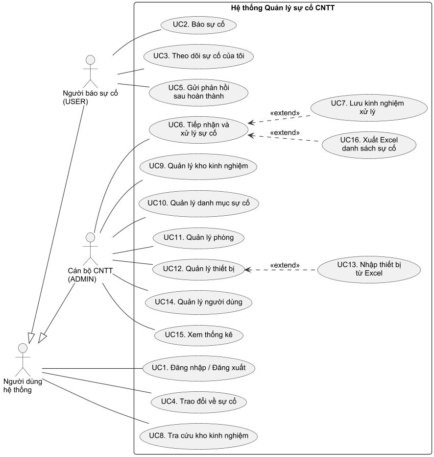

*Hình 1.1. Sơ đồ Use Case của hệ thống.*

**Tổng quát hóa actor.** Hai actor **Người báo sự cố** và **Cán bộ CNTT** cùng dùng một nhóm chức năng chung
(UC1, UC4, UC8) nhưng mỗi bên lại có chức năng riêng, đúng trường hợp dùng tổng quát hóa giữa các tác nhân
(Bài 4). Vì vậy sơ đồ vẽ actor cha **Người dùng hệ thống** nối với 3 UC chung; hai actor con kế thừa (mũi tên
tam giác rỗng trỏ về cha) nên đương nhiên được dùng 3 UC đó mà không phải vẽ thêm 6 đường nối.

Điều kiện của các quan hệ `«extend»`:

| Use case mở rộng | Use case gốc | Điều kiện mở rộng |
|---|---|---|
| UC7. Lưu kinh nghiệm xử lý | UC6. Tiếp nhận và xử lý sự cố | `luuKho = true` và chưa chọn bài kinh nghiệm có sẵn |
| UC16. Xuất Excel danh sách sự cố | UC6. Tiếp nhận và xử lý sự cố | Cán bộ CNTT bấm "Xuất Excel" trên danh sách sự cố đang lọc (`AdminController.xuatExcel`) |
| UC13. Nhập thiết bị từ Excel | UC12. Quản lý thiết bị | Nhập hàng loạt từ file `.xlsx` thay vì thêm từng dòng |

Không dùng `«include»` cho "Đăng nhập" trên từng UC còn lại để tránh làm sơ đồ rối (đăng nhập là **tiền
điều kiện** của mọi UC khác, không phải một bước con lặp lại có ý nghĩa nghiệp vụ riêng, xem khuyến cáo ở
Mục 4.1 của hướng dẫn BTL).

### 1.6. Danh sách Use Case

| Mã | Tên Use Case | Actor | Mô tả ngắn |
|---|---|---|---|
| UC1 | Đăng nhập / Đăng xuất | Người dùng hệ thống | Xác thực bằng email + mật khẩu, điều hướng theo vai trò. |
| UC2 | Báo sự cố | Người báo | Gửi báo cáo sự cố mới, có thể kèm 1 ảnh. |
| UC3 | Theo dõi sự cố của tôi | Người báo | Xem danh sách và chi tiết các sự cố mình đã báo, cùng lịch sử xử lý. |
| UC4 | Trao đổi về sự cố | Người dùng hệ thống (cả hai actor con) | Nhắn qua lại không giới hạn số lần trên một sự cố, có thể kèm file. |
| UC5 | Gửi phản hồi sau hoàn thành | Người báo | Đánh giá mức hài lòng 1–5 sao sau khi sự cố `HOÀN_THÀNH`. |
| UC6 | Tiếp nhận và xử lý sự cố | Cán bộ CNTT | Xem danh sách, đổi trạng thái, ghi nguyên nhân/cách khắc phục. |
| UC7 | Lưu kinh nghiệm xử lý | Cán bộ CNTT | Tạo bài kinh nghiệm mới ngay từ nội dung xử lý vừa nhập (extend của UC6). |
| UC8 | Tra cứu kho kinh nghiệm | Người dùng hệ thống (cả hai actor con) | Tìm và xem bài kinh nghiệm theo danh mục/từ khóa. |
| UC9 | Quản lý kho kinh nghiệm | Cán bộ CNTT | Thêm/sửa/xóa bài kinh nghiệm. |
| UC10 | Quản lý danh mục sự cố | Cán bộ CNTT | Thêm/sửa/xóa danh mục dùng chung cho sự cố và kinh nghiệm. |
| UC11 | Quản lý phòng | Cán bộ CNTT | Thêm/sửa/xóa phòng. |
| UC12 | Quản lý thiết bị | Cán bộ CNTT | Thêm/sửa/xóa thiết bị. |
| UC13 | Nhập thiết bị từ Excel | Cán bộ CNTT | Nhập hàng loạt thiết bị từ file `.xlsx` (extend của UC12). |
| UC14 | Quản lý người dùng | Cán bộ CNTT | Thêm/sửa tài khoản, đổi vai trò, đặt lại mật khẩu, vô hiệu hóa/kích hoạt lại. |
| UC15 | Xem thống kê | Cán bộ CNTT | Xem số liệu và biểu đồ tổng quan tình hình xử lý sự cố. |
| UC16 | Xuất Excel danh sách sự cố | Cán bộ CNTT | Xuất danh sách sự cố đang lọc ra file Excel (extend của UC6). |

### 1.7. Đặc tả Use Case tiêu biểu

#### UC2 — Báo sự cố

| Mục | Nội dung |
|---|---|
| Actor | Người báo |
| Mục tiêu | Ghi nhận một sự cố mới để cán bộ CNTT xử lý. |
| Tổng quan | Người dùng mô tả sự cố gặp phải trên form; hệ thống kiểm tra rồi lưu thành sự cố mới ở trạng thái MỚI. |
| Yêu cầu tham khảo | R1, R8; G1; Hình 1.2 (hoạt động), Hình 2.5 (SSD), Hình 3.3 (SD). |
| Tiền điều kiện | Đã đăng nhập với vai trò USER. |
| Luồng chính | 1. Người dùng chọn thiết bị liên quan (tùy chọn), danh mục sự cố, mức ưu tiên, nhập tiêu đề/mô tả, có thể đính kèm 1 ảnh. 2. Hệ thống kiểm tra dữ liệu hợp lệ. 3. Hệ thống lưu sự cố mới ở trạng thái `MỚI`, gắn người báo là người dùng hiện tại. 4. Hệ thống báo đã ghi nhận. |
| Luồng thay thế/ngoại lệ | 2a. Thiếu tiêu đề hoặc mức ưu tiên không hợp lệ → báo lỗi, không lưu. 3a. File đính kèm sai định dạng (không phải JPG/PNG/GIF/WEBP) → báo lỗi, không lưu. 3b. File vượt 5MB → báo lỗi "File quá lớn", không lưu. |
| Hậu điều kiện | Một dòng mới trong danh sách sự cố ở trạng thái `MỚI`, xuất hiện ngay trong danh sách của cán bộ CNTT (UC6). |

#### UC6 — Tiếp nhận và xử lý sự cố (kèm UC7 — Lưu kinh nghiệm xử lý)

| Mục | Nội dung |
|---|---|
| Actor | Cán bộ CNTT |
| Mục tiêu | Cập nhật tiến độ xử lý một sự cố, ghi lại nguyên nhân và cách khắc phục. |
| Tổng quan | Cán bộ CNTT mở một sự cố, đổi trạng thái, ghi nguyên nhân/cách khắc phục; có thể gắn bài kinh nghiệm có sẵn hoặc lưu kết quả thành bài mới (UC7). |
| Yêu cầu tham khảo | R1, R2, R5; G2; Hình 1.3 (hoạt động), Hình 2.6 (SSD), Hình 3.4 và 3.7 (SD, giao tiếp), Hình 3.13 (trạng thái). |
| Tiền điều kiện | Đã đăng nhập với vai trò ADMIN; sự cố tồn tại. |
| Luồng chính | 1. Cán bộ CNTT mở chi tiết một sự cố. 2. Chọn trạng thái mới, nhập nguyên nhân/cách khắc phục, có thể chọn 1 bài kinh nghiệm có sẵn để gắn vào. 3. Hệ thống lưu cập nhật; nếu trạng thái thực sự đổi thì tự ghi 1 dòng lịch sử; nếu chuyển sang `HOÀN_THÀNH` thì tự gán ngày hoàn thành. |
| Luồng thay thế/ngoại lệ (UC7, extend) | 2a. Nếu tick "lưu vào kho kinh nghiệm" mà **không** chọn bài có sẵn: phải nhập đủ nguyên nhân, cách khắc phục và chọn danh mục kho; hệ thống tạo một bài kinh nghiệm mới (dùng chính tiêu đề/mô tả của sự cố) rồi tự gắn bài đó vào sự cố đang xử lý. 2b. Thiếu nguyên nhân/cách khắc phục/danh mục khi đã tick "lưu vào kho" → báo lỗi, không lưu cập nhật. |
| Luồng thay thế/ngoại lệ (khác) | 1a. Trạng thái gửi lên không nằm trong {MỚI, ĐANG_XỬ_LÝ, HOÀN_THÀNH} → báo lỗi "Trạng thái không hợp lệ". |
| Hậu điều kiện | Sự cố có trạng thái/nguyên nhân/cách khắc phục mới; có thêm 1 dòng lịch sử xử lý; (nếu UC7 xảy ra) kho kinh nghiệm có thêm 1 bài mới. |

#### UC5 — Gửi phản hồi sau hoàn thành

| Mục | Nội dung |
|---|---|
| Actor | Người báo |
| Mục tiêu | Đánh giá mức độ hài lòng về cách xử lý sự cố của chính mình. |
| Tổng quan | Sau khi sự cố hoàn thành, người báo chấm 1–5 sao và có thể để lại nhận xét. |
| Yêu cầu tham khảo | R3; Hình 2.7 (SSD), Hình 3.5 (SD), Hình 3.13 (tự chuyển ở HOAN_THANH). |
| Tiền điều kiện | Sự cố thuộc về người dùng hiện tại và đã ở trạng thái `HOÀN_THÀNH`. |
| Luồng chính | 1. Người dùng chọn mức hài lòng (1–5), có thể nhập nhận xét. 2. Hệ thống lưu phản hồi, gắn với sự cố. |
| Luồng thay thế/ngoại lệ | 1a. Sự cố chưa `HOÀN_THÀNH` → báo lỗi, không cho gửi. 1b. Mức hài lòng ngoài khoảng 1–5 → báo lỗi. 2a. Sự cố đã có phản hồi trước đó (ràng buộc duy nhất ở CSDL) → hệ thống bắt lỗi và báo "Sự cố này đã được phản hồi rồi" thay vì để lộ lỗi SQL. |
| Hậu điều kiện | Sự cố có đúng 1 bản ghi phản hồi. |

#### UC4 — Trao đổi về sự cố

| Mục | Nội dung |
|---|---|
| Actor | Người báo, Cán bộ CNTT |
| Mục tiêu | Trao đổi thông tin bổ sung qua lại trên một sự cố cụ thể, không chờ xử lý xong. |
| Tổng quan | Hai bên nhắn tin, gửi file qua lại ngay trên trang chi tiết sự cố; trang tự kiểm tra và hiển thị tin mới mà không cần tải lại. |
| Yêu cầu tham khảo | R4, R8; Hình 2.8 (SSD), Hình 3.6 (SD). |
| Tiền điều kiện | Đã đăng nhập; với Người báo, sự cố phải thuộc về mình. |
| Luồng chính | 1. Người gửi nhập nội dung và/hoặc chọn 1 file đính kèm. 2. Hệ thống lưu tin nhắn kèm thời gian gửi. 3. Phía còn lại thấy tin nhắn mới khi mở lại trang chi tiết (trang tự kiểm tra tin mới định kỳ). |
| Luồng thay thế/ngoại lệ | 1a. Không nhập nội dung và không chọn file → báo lỗi "Nhập nội dung hoặc chọn file để gửi". 1b. File sai định dạng hoặc vượt 5MB → báo lỗi tương ứng. |
| Hậu điều kiện | Thêm 1 dòng trao đổi mới cho sự cố, sắp theo thời gian gửi. |

### 1.8. Sơ đồ hoạt động (Activity Diagram)

Sơ đồ hoạt động là cầu nối giữa đặc tả UC (§1.7) và sơ đồ tuần tự (§3.2): nó làm lộ ra các rẽ nhánh, vòng lặp
và việc song song mà văn bản dạng "bước 1, 2, 3" dễ bỏ sót.

**Quy trình nghiệp vụ tổng thể của một sự cố.** Mỗi làn (swimlane) cho biết ai chịu trách nhiệm hoạt động đó.

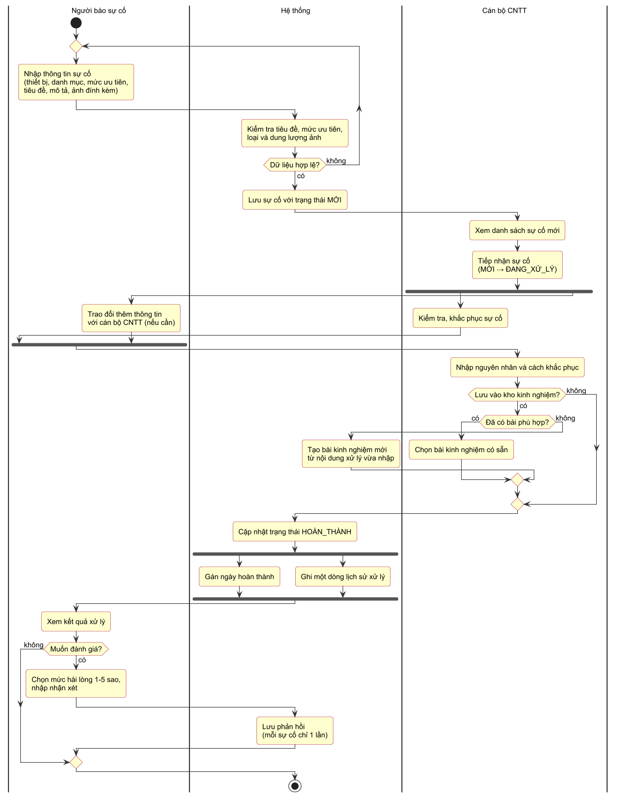

*Hình 1.2. Quy trình xử lý một sự cố, từ lúc báo đến khi phản hồi (có swimlane).*

Các điểm cần đọc trên hình:

- Vòng lặp ở đầu: dữ liệu không hợp lệ thì người dùng sửa và gửi lại (luồng ngoại lệ 2a, 3a, 3b của UC2).
- Thanh fork/join thứ nhất: trong lúc cán bộ CNTT xử lý, hai bên vẫn trao đổi song song (quy tắc R4).
- Rẽ nhánh lồng nhau "Lưu vào kho kinh nghiệm?" / "Đã có bài phù hợp?" chính là UC7 (quy tắc R5).
- Thanh fork/join thứ hai: gán ngày hoàn thành và ghi lịch sử là hai việc độc lập, cùng xảy ra khi đổi
  trạng thái (quy tắc R2, do 2 trigger đảm nhận).
- Phản hồi chỉ có sau khi hoàn thành và là tùy chọn (quy tắc R3).

**Chi tiết logic của UC6 + UC7** (`AdminController.capNhat` và `SuCoRepo.capNhat`). Phần UC7 được đóng gói
thành một vùng riêng theo cách "phân hoạch sơ đồ" của Bài 5.

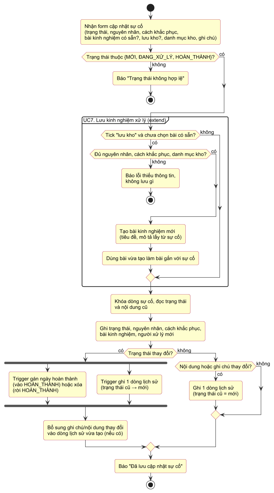

*Hình 1.3. Logic cập nhật xử lý sự cố, kèm nhánh lưu kinh nghiệm.*

Hình này cho thấy một chi tiết mà đặc tả bằng chữ ở §1.7 chưa nói: **khi giữ nguyên trạng thái nhưng sửa
nguyên nhân, cách khắc phục hoặc ghi chú**, hệ thống vẫn ghi một dòng lịch sử (trạng thái cũ = mới) để không
mất dấu vết lần sửa trước. Trigger chỉ chạy khi trạng thái đổi, nên trường hợp này do `SuCoRepo.capNhat` tự làm.

### 1.9. Yêu cầu phi chức năng (NFR)

| NFR | Mô tả | Thể hiện trong hệ thống |
|---|---|---|
| Bảo mật mật khẩu | Không lưu mật khẩu dạng rõ. | Băm PBKDF2-HMAC-SHA256 + salt ngẫu nhiên (`util/MatKhau.java`) trước khi lưu. |
| Phân quyền theo vai trò | Người dùng thường không được vào khu vực quản trị. | `AuthInterceptor` chặn truy cập `/admin/**` nếu không phải ADMIN, và chặn mọi route nếu chưa đăng nhập. |
| Khả năng dùng trên di động | Giao viên/sinh viên có thể báo sự cố ngay từ điện thoại. | Giao diện Bootstrap 5 responsive, bảng tự xếp thành thẻ dưới 768px. |
| Toàn vẹn dữ liệu tối thiểu | Email, tên phòng, tên thiết bị không được trùng; không phá vỡ khóa ngoại khi xóa. | Ràng buộc UNIQUE/CHECK/FK ở CSDL, kiểm tra trước ở tầng ứng dụng để báo lỗi dễ hiểu hơn mã lỗi Oracle. |
| Giới hạn tài nguyên tải lên | Tránh chiếm quá nhiều dung lượng đĩa. | Giới hạn loại file và dung lượng tối đa 5MB/file (`XuLyLoiChung`, `BoLuuTru`). |

---

## CHƯƠNG 2. MÔ HÌNH PHÂN TÍCH

### 2.1. Xác định lớp bằng phân tích danh từ

Các lớp ứng viên được rút ra bằng cách gạch chân danh từ/cụm danh từ trong mô tả bài toán (§1.1), quy tắc
nghiệp vụ (§1.3) và đặc tả UC (§1.7), rồi lọc theo tiêu chí giữ/bỏ của Bài 7:

| Danh từ / cụm danh từ | Quyết định | Lý do |
|---|---|---|
| Hệ thống, trường đại học | Loại | Là toàn bộ hệ thống hoặc chỉ là bối cảnh, không phải khái niệm trong miền |
| Sinh viên, giảng viên, cán bộ | Gộp thành lớp **NguoiDung** (vai trò USER) | Cùng dữ liệu, cùng hành vi trong hệ thống; khác biệt không ảnh hưởng nghiệp vụ |
| Bộ phận CNTT, cán bộ CNTT | Gộp vào **NguoiDung** (vai trò ADMIN) | Tránh hai lớp trùng nghĩa; phân biệt bằng thuộc tính vai trò |
| Sự cố | Lớp **SuCo** | Thực thể trung tâm, có vòng đời MỚI → ĐANG_XỬ_LÝ → HOÀN_THÀNH |
| Phòng (phòng máy, phòng học, văn phòng) | Lớp **Phong**; "phòng máy/phòng học" là thuộc tính *loại phòng* | Có dữ liệu riêng, chứa thiết bị |
| Thiết bị (máy tính, máy chiếu, máy in...) | Lớp **ThietBi**; "máy tính/máy chiếu" là thuộc tính *loại* | Có tình trạng riêng, được sự cố tham chiếu |
| Loại sự cố (thiết bị, mạng, phần mềm, tài khoản) | Lớp **DanhMucSuCo** | Dùng chung cho sự cố và bài kinh nghiệm; cán bộ CNTT thêm/sửa được (UC10) nên không thể là enum cứng |
| Cách xử lý, kinh nghiệm | Lớp **BaiKinhNghiem** | Bền vững theo thời gian, cần tra cứu lại |
| Tiến độ xử lý, lịch sử xử lý | Lớp **LanXuLy** | Hành động cần lưu thời điểm và người thực hiện, một sự cố có nhiều lần → phải là lớp, không phải phương thức |
| Trao đổi, tin nhắn | Lớp **TraoDoi** | Nhiều lần, có tệp đính kèm, có thời điểm |
| Đánh giá, mức hài lòng | Lớp **PhanHoi** | Có dữ liệu riêng và quy tắc riêng (1 lần, chỉ sau khi hoàn thành) |
| Mức ưu tiên, trạng thái, nguyên nhân, cách khắc phục | Thuộc tính của **SuCo** | Chỉ là giá trị đơn giản |
| Ảnh, file đính kèm | Thuộc tính (đường dẫn tệp) | Không có hành vi riêng ở mức nghiệp vụ |
| Email, mật khẩu, số điện thoại | Thuộc tính của **NguoiDung** | Giá trị đơn giản |
| Thống kê, báo cáo Excel | Loại | Là kết quả tính toán khi xem, không lưu bền vững |
| Email/SMS thông báo | Loại | Nằm ngoài phạm vi (§1.1) |

Đối chiếu với cách phân loại của Coad & Yourdon: *vật thể* là ThietBi, Phong; *vai trò* là NguoiDung
(USER/ADMIN); *sự kiện có vòng đời* là SuCo, LanXuLy, PhanHoi, TraoDoi; *khái niệm* là DanhMucSuCo, BaiKinhNghiem.

### 2.2. Mô hình khái niệm (Conceptual Model)

Ở mức phân tích, mô hình chỉ thể hiện các khái niệm nghiệp vụ và quan hệ giữa chúng: **không** đưa khóa kỹ
thuật (ID), kiểu dữ liệu hay phương thức vào đây (những thứ đó thuộc Chương 3). Dấu `>` sau tên quan hệ chỉ
chiều đọc (ví dụ "Phong *chứa >* ThietBi").

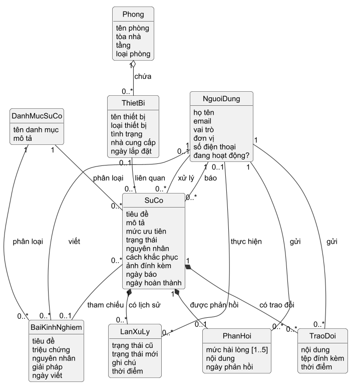

*Hình 2.1. Mô hình khái niệm.*

**Giải thích các quyết định:**

- Dùng đủ các kiểu liên kết của Bài 6:
  - **Gộp (composition, hình thoi đặc)** giữa `SuCo` và `LanXuLy`, `PhanHoi`, `TraoDoi`: các đối tượng này không
    tồn tại độc lập nếu không có sự cố; xóa sự cố thì `SuCoRepo.xoa` xóa luôn lịch sử, phản hồi và trao đổi của nó.
  - **Kết tập (aggregation, hình thoi rỗng)** giữa `Phong` và `ThietBi`: thiết bị là một phần của phòng nhưng vẫn
    tồn tại độc lập (chuyển được sang phòng khác), và không xóa được phòng khi còn thiết bị (R7).
  - Các quan hệ còn lại là **kết hợp (association)** thông thường.
- `LanXuLy` là một khái niệm có ý nghĩa riêng (một lần cập nhật, với thời điểm và người thực hiện), không gộp
  vào `SuCo` vì một sự cố có **nhiều** lần cập nhật theo thời gian, mỗi lần có dữ liệu riêng.
- `PhanHoi` và `TraoDoi` tách thành 2 lớp riêng dù cùng là "phản ứng của người báo trên một sự cố", vì quy
  tắc nghiệp vụ khác hẳn nhau: `PhanHoi` chỉ 1 lần/sự cố và chỉ sau khi hoàn thành (bội số `0..1`), còn
  `TraoDoi` không giới hạn số lần và không ràng buộc trạng thái (bội số `0..*`).
- `ThietBi` liên kết tới `SuCo` là `0..1` (phía ThietBi) vì một sự cố **không bắt buộc** gắn thiết bị (ví dụ
  sự cố quên mật khẩu không liên quan thiết bị vật lý nào).
- Không đưa "Tài khoản AI/hệ thống ngoài" vào mô hình vì nằm ngoài phạm vi (§1.1).

### 2.3. Phân bổ trách nhiệm (thẻ CRC)

Mỗi lớp là một thẻ riêng gồm 3 phần Class, Responsibility, Collaborator (Bài 8). Trách nhiệm được ghi ở mức
"cái gì" theo hai loại: **biết** (dữ liệu lớp nắm giữ) và **làm** (dịch vụ lớp cung cấp). Hai thẻ cuối là lớp
điều khiển, chuẩn bị cho mô hình BCE (§2.4); trong mã nguồn chúng tương ứng `SuCoController` và `AdminController`.

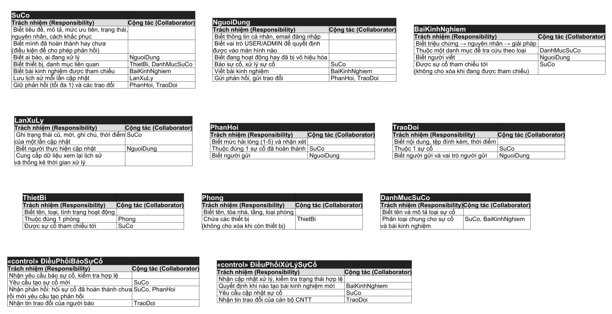

*Hình 2.2. Thẻ CRC của các lớp chính.*

Nguyên tắc GRASP áp dụng rõ nhất ở đây là **Information Expert**: `SuCo` được giao trách nhiệm tự biết mình đã
hoàn thành hay chưa (thay vì để Controller so sánh chuỗi trạng thái), vì chính `SuCo` nắm dữ liệu
`trangThai`. Chi tiết cài đặt tương ứng (`SuCo.daHoanThanh()`) xem ở §3.2 (Hình 3.5) và §3.5.

Tinh chỉnh lớp sau khi viết thẻ (Bài 8):

- **Không gộp** `PhanHoi` với `TraoDoi`: hai thẻ có trách nhiệm khác nhau (1 lần sau hoàn thành và nhiều lần bất kỳ lúc nào).
- **Không tạo** lớp `ThongKe` trong miền: thẻ của nó sẽ không có trách nhiệm "biết" nào riêng (lazy class); số
  liệu thống kê được tính bằng truy vấn tổng hợp ở `ThongKeRepo` khi cần.
- Cột Collaborator của `SuCo` dài nhất vì đây là thực thể trung tâm; các lớp khác chỉ cộng tác với 1–2 lớp,
  cho thấy độ phụ thuộc giữa các lớp thấp (Low Coupling).

### 2.4. Mô hình phân tích BCE (Boundary – Control – Entity)

Bổ sung lớp biên (Boundary) và lớp điều khiển (Control) cho từng nhóm UC (Bài 6, Bài 7): mỗi actor có ít nhất
một lớp biên, mỗi nhóm UC phức tạp có một lớp điều khiển, còn lớp thực thể lấy từ mô hình khái niệm. Các quy
tắc tương tác: actor chỉ làm việc với Boundary; Boundary chỉ gửi yêu cầu cho Control, không gọi thẳng Entity;
Control điều phối Entity; Entity không chủ động gọi Boundary hay Control.

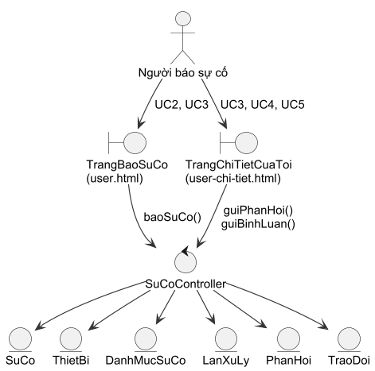

*Hình 2.3. Lớp phân tích BCE phía Người báo sự cố (UC2, UC3, UC4, UC5).*

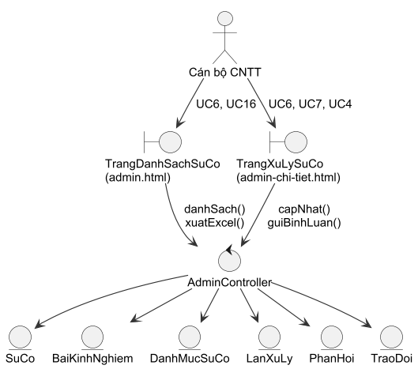

*Hình 2.4. Lớp phân tích BCE phía Cán bộ CNTT (UC4, UC6, UC7, UC16).*

Ánh xạ sang công nghệ: Boundary là template Thymeleaf, Control là các lớp `*Controller` của Spring MVC, Entity
là lớp model cùng `*Repo` đọc/ghi CSDL (xem §3.1).

### 2.5. System Sequence Diagram (SSD)

SSD chỉ thể hiện tương tác **Actor ↔ Hệ thống** như một hộp đen, chưa phân rã nội bộ (phần phân rã thuộc
§3.2). Thông điệp được đánh số theo đúng thứ tự trong kịch bản; khung `alt` là các luồng thay thế/ngoại lệ đã
đặc tả ở §1.7.

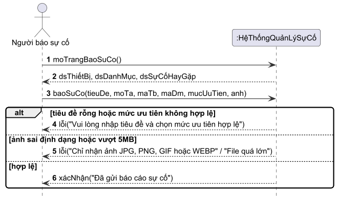

*Hình 2.5. SSD của UC2 Báo sự cố.*

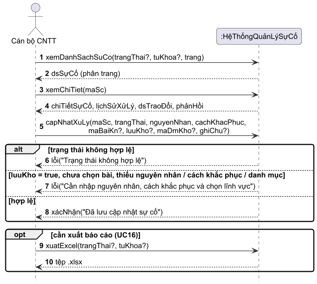

*Hình 2.6. SSD của UC6 Tiếp nhận và xử lý sự cố (kèm UC7, UC16).*

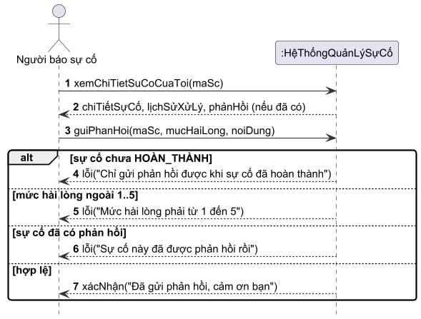

*Hình 2.7. SSD của UC5 Gửi phản hồi.*

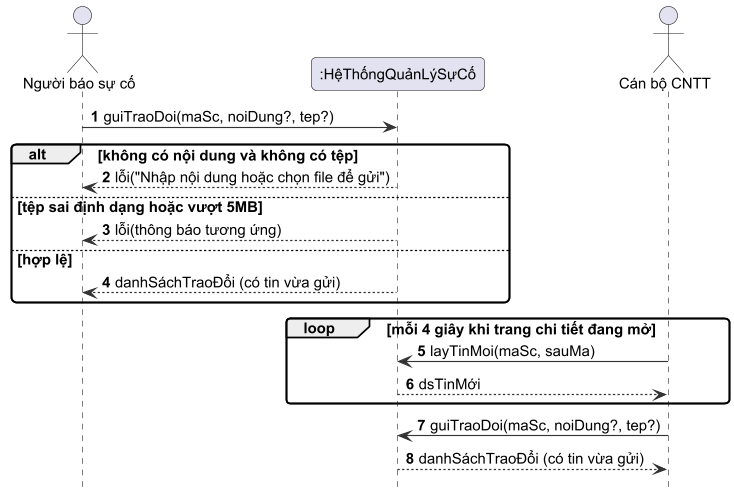

*Hình 2.8. SSD của UC4 Trao đổi về sự cố.*


### 2.6. Điểm mơ hồ và cách nhóm quyết định xử lý

- **Thứ tự trạng thái không bị ép buộc:** đề bài gốc không nói rõ việc đổi trạng thái có phải đi tuần tự
  `MỚI → ĐANG_XỬ_LÝ → HOÀN_THÀNH` hay không. Nhóm **giả định** quy trình thực tế là tuần tự (R1), nhưng
  **quyết định không ép buộc ở tầng ứng dụng** để cán bộ CNTT có thể xử lý nhanh một sự cố đơn giản (đổi
  thẳng từ `MỚI` sang `HOÀN_THÀNH`) mà không phải thao tác 2 bước. Đây là đánh đổi linh hoạt-vs-chặt chẽ cần
  nêu rõ khi bảo vệ (xem thêm State Machine ở §3.4).
- **Một thiết bị có thể liên quan nhiều sự cố cùng lúc:** đề bài không giới hạn; nhóm giả định một thiết bị
  "đang hỏng" vẫn có thể bị báo thêm sự cố mới (không khóa báo cáo trùng), vì nhiều người có thể phát hiện
  cùng một vấn đề độc lập với nhau.
- **"Lưu vào kho kinh nghiệm" là tùy chọn, không bắt buộc:** nhóm quyết định không ép mọi sự cố `HOÀN_THÀNH`
  đều phải sinh ra bài kinh nghiệm, vì nhiều sự cố (ví dụ quên mật khẩu) không có giá trị tra cứu lại.

---

## CHƯƠNG 3. THIẾT KẾ HỆ THỐNG

### 3.1. Kiến trúc và phân tầng trách nhiệm

Hệ thống dùng kiến trúc 3 tầng theo tư duy Boundary–Control–Entity, ánh xạ sang Spring MVC như sau (không
có tầng Service riêng — Controller đồng thời đóng vai trò điều phối/Control, vì nghiệp vụ ở quy mô đồ án
chưa đủ phức tạp để tách thêm một tầng; đây là lựa chọn có chủ đích, không phải thiếu sót):

| Vai trò BCE | Thành phần | Trách nhiệm |
|---|---|---|
| Boundary (giao diện) | Template Thymeleaf (`templates/*.html`) | Hiển thị dữ liệu, nhận input form, không chứa logic nghiệp vụ. |
| Control (điều phối) | `*Controller` (`SuCoController`, `AdminController`, `AuthController`...) | Tiếp nhận HTTP request, kiểm tra hợp lệ ở mức bề mặt (ví dụ trường bắt buộc), gọi Repository tương ứng, chọn view/redirect trả về. |
| Entity (miền nghiệp vụ) | `model/*` (`SuCo`, `NguoiDung`...) + `*Repo` (`SuCoRepo`...) | Model giữ dữ liệu và một số quy tắc gắn liền với chính nó (`SuCo.daHoanThanh()`); Repo là nơi duy nhất biết cấu trúc bảng/CSDL (Information Expert cho việc đọc/ghi dữ liệu). |
| Cắt ngang (cross-cutting) | `AuthInterceptor`, `XuLyLoiChung` | Xác thực/phân quyền và xử lý lỗi tập trung cho **mọi** controller, tách khỏi từng Controller cụ thể (Pure Fabrication — xem §3.5). |

**Phân hoạch (partition): chia theo chức năng.** Các controller được nhóm thành 5 gói nghiệp vụ; mũi tên nét
đứt là phụ thuộc giữa các gói (gói nguồn dùng thông tin/dịch vụ của gói đích).

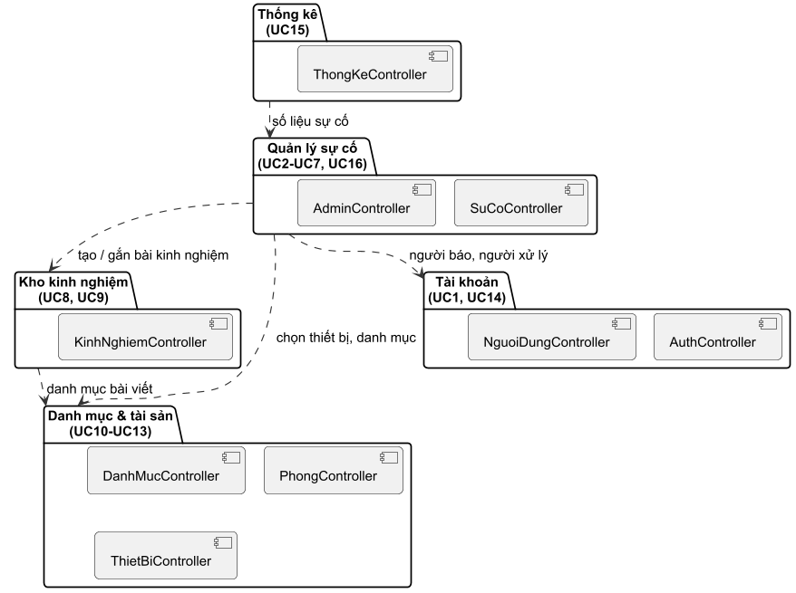

*Hình 3.1. Phân hoạch hệ thống theo chức năng nghiệp vụ.*

Gói "Quản lý sự cố" phụ thuộc nhiều nhất (cần thiết bị, danh mục, người dùng, kho kinh nghiệm), còn "Danh mục
& tài sản" không phụ thuộc gói nào: thay đổi ở gói lõi này sẽ ảnh hưởng các gói khác, nên cần giữ ổn định.

**Phân tầng (layering): chia theo trách nhiệm kỹ thuật.** Phụ thuộc chỉ đi một chiều từ trên xuống, giao diện
không gọi thẳng Repo hay CSDL.

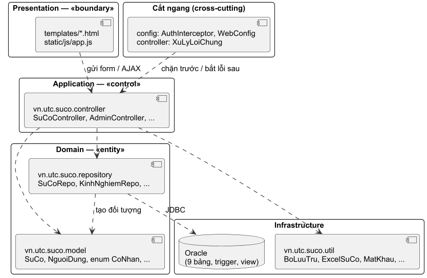

*Hình 3.2. Phân tầng hệ thống và ánh xạ sang các package Java.*


### 3.2. Sequence Diagram (mức thiết kế)

Các sơ đồ tuần tự mở "hộp đen" của SSD (§2.5) theo đúng thứ tự **Actor → Boundary → Control → Entity**
(Bài 10). Quy ước trên hình:

- Icon hình tròn có vạch đứng bên trái là Boundary (template Thymeleaf); hình tròn có mũi tên là Control
  (`*Controller`); hình tròn có gạch dưới là Entity (`*Repo` và đối tượng model); hình trụ là CSDL Oracle.
- Thông điệp được đánh số theo thời gian; thanh dọc là activation bar; `«create»` là lúc một đối tượng được tạo
  ra (lifeline của nó bắt đầu từ giữa hình).
- Tên thông điệp là tên phương thức thật trong mã nguồn; tham số hạ tầng của Spring (`HttpSession`, `Model`,
  `RedirectAttributes`) được lược bỏ.

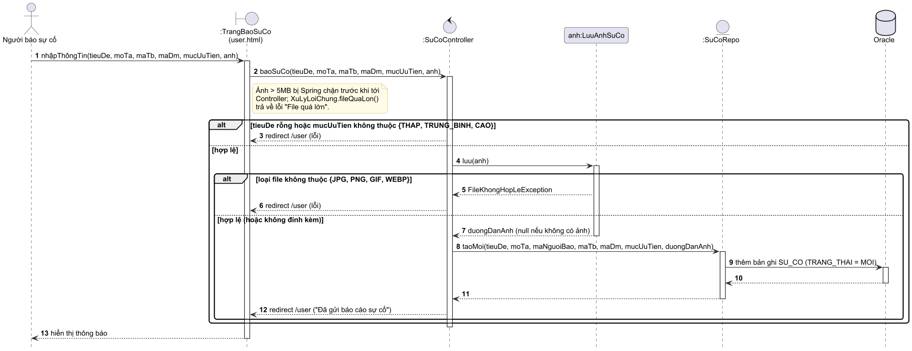

*Hình 3.3. Sơ đồ tuần tự UC2 Báo sự cố.*

Kiểm tra bề mặt (tiêu đề, mức ưu tiên) do Controller làm; kiểm tra loại file giao cho `LuuAnhSuCo` (lớp con của
`BoLuuTru`, xem §3.3). Controller chỉ bắt `FileKhongHopLeException` để chọn thông báo hiển thị.

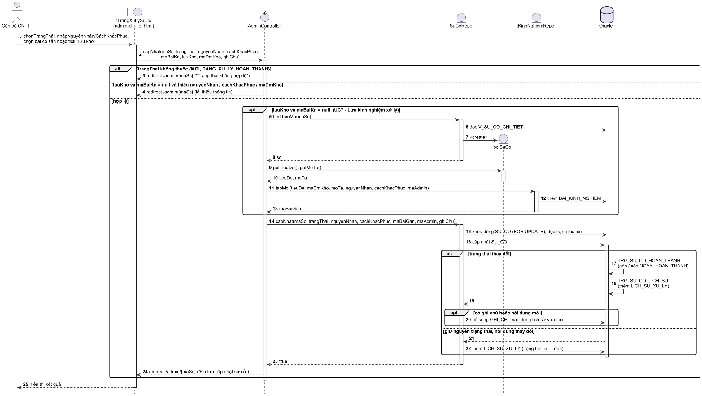

*Hình 3.4. Sơ đồ tuần tự UC6 Xử lý sự cố, kèm nhánh UC7 tự tạo bài kinh nghiệm.*

Khung `opt` chính là quan hệ `«extend»` UC7 → UC6 trên sơ đồ Use Case. Hai trigger là thông điệp tự gọi trên
lifeline Oracle, cho thấy trách nhiệm ghi lịch sử và gán ngày hoàn thành được đẩy xuống tầng dữ liệu (xem §3.6).

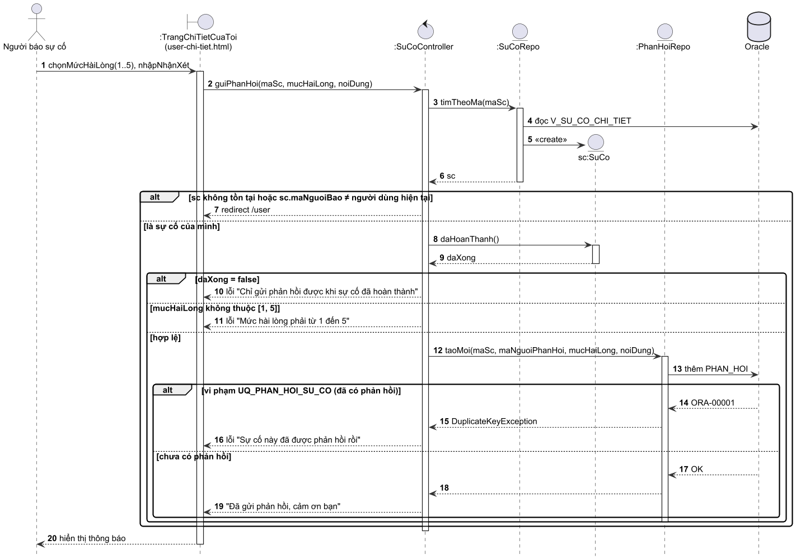

*Hình 3.5. Sơ đồ tuần tự UC5 Gửi phản hồi.*

Controller không tự so sánh chuỗi `"HOAN_THANH"` mà **hỏi chính đối tượng** `sc:SuCo` qua `daHoanThanh()` (thông
điệp 8): `SuCo` là Information Expert vì nó giữ `trangThai`. Quy tắc "mỗi sự cố chỉ 1 phản hồi" được bảo đảm lần
cuối bởi ràng buộc `UQ_PHAN_HOI_SU_CO`; Controller bắt `DuplicateKeyException` để hiện thông báo dễ hiểu thay vì
để lộ mã lỗi ORA-00001.

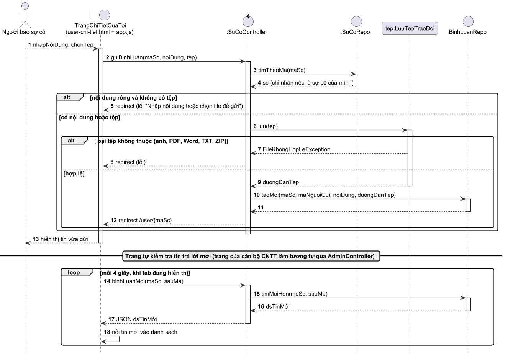

*Hình 3.6. Sơ đồ tuần tự UC4 Trao đổi về sự cố (gửi tin và tự cập nhật tin mới).*

Khung `loop` là việc trang chi tiết (`app.js`) cứ 4 giây gọi `binhLuanMoi(maSc, sauMa)` để chỉ lấy những tin có mã
lớn hơn tin mới nhất đang hiển thị, nhờ đó phía bên kia thấy tin trả lời mà không phải tải lại trang.

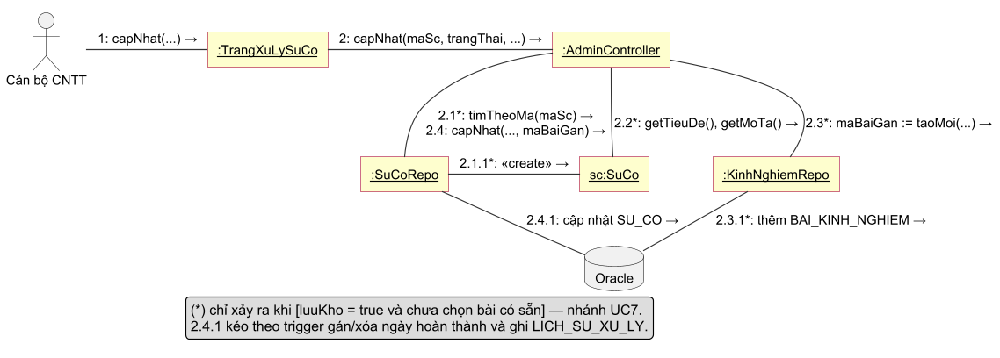

*Hình 3.7. Sơ đồ giao tiếp (Communication Diagram) cho UC6 + UC7.*

Cùng nội dung với Hình 3.4 nhưng nhìn theo **cấu trúc cộng tác** ("ai nói chuyện với ai") thay vì theo thời gian.
Hình cho thấy ngay `:AdminController` là đầu mối duy nhất nối giao diện với các đối tượng phía sau (Low
Coupling), còn `:TrangXuLySuCo` không gọi thẳng Repo nào. Số thứ tự phân cấp (2.1, 2.1.1...) cho biết thông
điệp nào được gửi trong lúc đang xử lý thông điệp nào.

### 3.3. Design Class Diagram (DCD)

Khác với mô hình khái niệm (§2.2), DCD ghi đủ **kiểu dữ liệu**, **mức truy cập** (`+` public, `-` private,
`#` protected), **chiều điều hướng** (mũi tên) và **bội số**, đủ chi tiết để lập trình (Bài 11). Quy ước:

- Mũi tên liền có tên vai trò (ví dụ `-suCoRepo`) và bội số `1`: lớp nguồn giữ một thuộc tính `private final`
  kiểu lớp đích, do Spring tiêm qua constructor, nên thuộc tính đó không lặp lại trong ô thuộc tính.
- Mũi tên nét đứt `«create»`: lớp nguồn tạo ra đối tượng lớp đích (Repo dựng đối tượng model từ dòng dữ liệu).
- Chỉ liệt kê các phương thức tham gia các UC đã phân tích; danh sách đầy đủ xem `src/main/java/vn/utc/suco/`.

DCD được tách thành nhiều hình theo nhóm trách nhiệm để không quá rộng khi in.

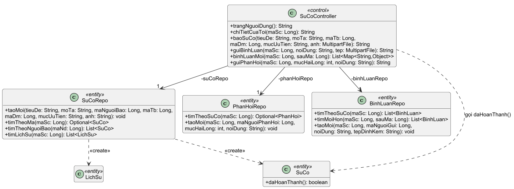

*Hình 3.8. DCD phía Người báo sự cố (UC2, UC3, UC4, UC5).*

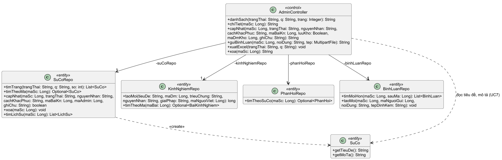

*Hình 3.9. DCD phía Cán bộ CNTT (UC6, UC7, UC16).*

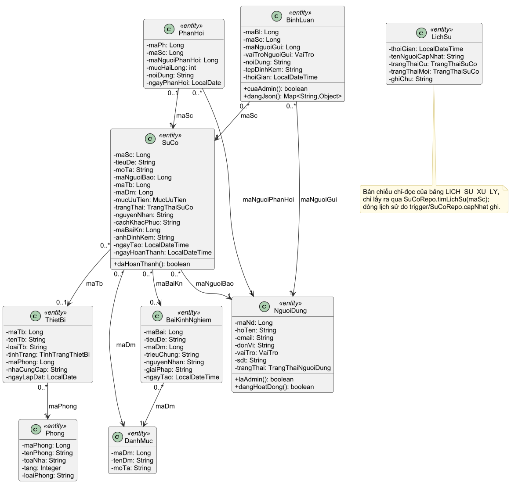

*Hình 3.10. Các lớp thực thể (package model).*

Ở tầng cài đặt, liên kết giữa các thực thể được hiện thực bằng **thuộc tính khóa** (`maTb: Long`, `maDm: Long`...)
chứ không giữ tham chiếu đối tượng; tên trên mũi tên là thuộc tính hiện thực liên kết đó, chiều mũi tên là
chiều điều hướng (từ `SuCo` biết được `ThietBi`, chiều ngược lại phải truy vấn). Cách này phù hợp với
JdbcTemplate, vì dự án không dùng ORM.

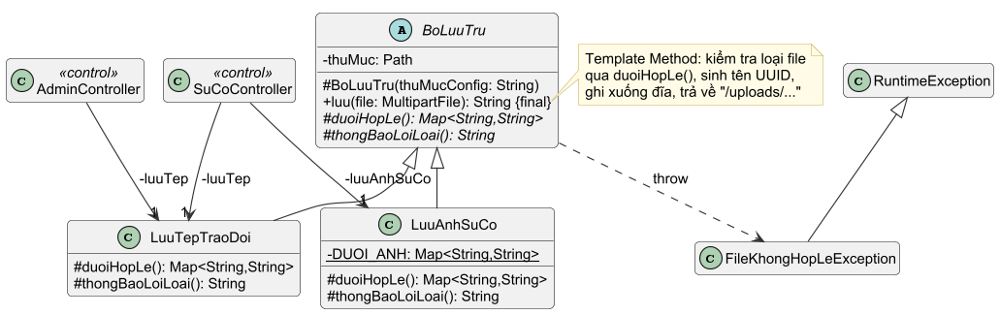

*Hình 3.11. Lưu tệp tải lên theo mẫu Template Method.*

`luu()` là phương thức `final` của lớp trừu tượng `BoLuuTru`: bước kiểm tra loại file, sinh tên UUID và ghi đĩa là
chung; hai lớp con chỉ cài lại `duoiHopLe()` và `thongBaoLoiLoai()` (xem Polymorphism + OCP ở §3.5).

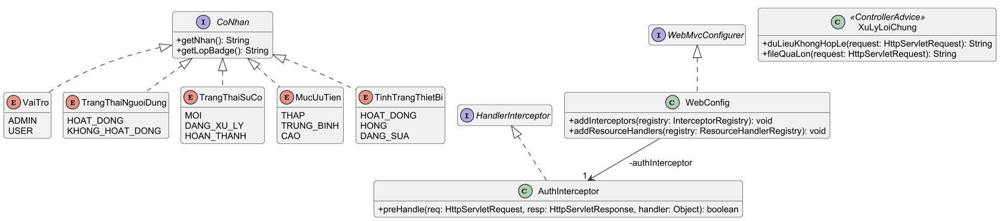

*Hình 3.12. Kiểu nhãn dùng chung và lớp hạ tầng web.*

`WebConfig` giữ tham chiếu tới `AuthInterceptor` để đăng ký nó chặn mọi request trước khi vào Controller.
`XuLyLoiChung` (`@ControllerAdvice`) không có liên kết tới lớp nào vì Spring gọi nó theo cấu hình khi có ngoại lệ,
không qua tham chiếu trong code.

### 3.4. State Machine

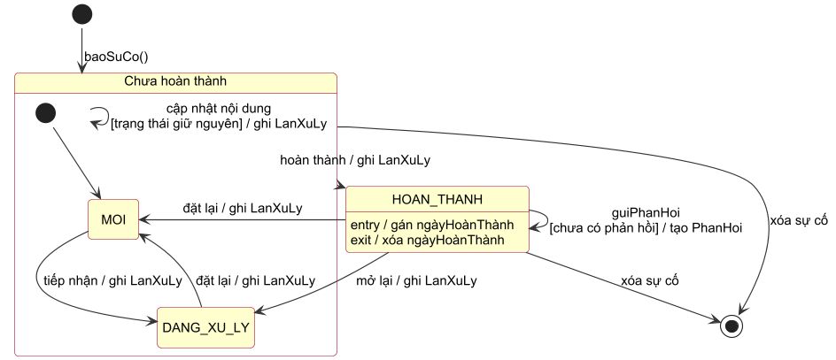

*Hình 3.13. Sơ đồ trạng thái của SuCo (thuộc tính trangThai).*

Nhãn trên mũi tên theo dạng `sự kiện [điều kiện] / hành động` (Bài 9):

- Siêu trạng thái **Chưa hoàn thành** gom `MOI` và `DANG_XU_LY`. Mũi tên "hoàn thành" đi ra từ khung lớn nghĩa là
  từ *bất kỳ* trạng thái con nào cũng chuyển thẳng được sang `HOAN_THANH`, gộp hai chuyển MOI → HOAN_THANH và
  DANG_XU_LY → HOAN_THANH thành một.
- `HOAN_THANH` có hành động **entry/exit**: vào trạng thái thì gán `NGAY_HOAN_THANH`, rời trạng thái thì xóa,
  đúng ngữ nghĩa trigger `TRG_SU_CO_HOAN_THANH`. Nhờ dùng entry/exit nên không phải lặp lại hành động này trên
  từng mũi tên.
- Mọi chuyển giữa hai trạng thái khác nhau đều kèm hành động `ghi LanXuLy` (trigger `TRG_SU_CO_LICH_SU`).
- Hai **tự chuyển (self-transition)**: sửa nội dung mà giữ nguyên trạng thái vẫn ghi `LanXuLy` (do
  `SuCoRepo.capNhat` tự làm); ở `HOAN_THANH`, người báo gửi phản hồi được đúng 1 lần (điều kiện `[chưa có phản hồi]`).
- Trạng thái kết thúc: cán bộ CNTT xóa sự cố (`AdminController.xoa`) ở bất kỳ trạng thái nào.

| Sự kiện | Chuyển trạng thái | Nơi xảy ra trong mã nguồn |
|---|---|---|
| `baoSuCo()` | bắt đầu → `MOI` | `SuCoController.baoSuCo` → `SuCoRepo.taoMoi` |
| tiếp nhận | `MOI` → `DANG_XU_LY` | `AdminController.capNhat` |
| hoàn thành | `MOI` / `DANG_XU_LY` → `HOAN_THANH` | `AdminController.capNhat` |
| mở lại | `HOAN_THANH` → `DANG_XU_LY` | `AdminController.capNhat` |
| đặt lại | `DANG_XU_LY` / `HOAN_THANH` → `MOI` | `AdminController.capNhat` |
| cập nhật nội dung | giữ nguyên trạng thái | `SuCoRepo.capNhat` (tự thêm 1 dòng `LICH_SU_XU_LY`) |
| `guiPhanHoi` | `HOAN_THANH` (giữ nguyên) | `SuCoController.guiPhanHoi` |
| xóa sự cố | bất kỳ → kết thúc | `AdminController.xoa` |

Sơ đồ phản ánh **đúng những gì mã nguồn hiện cho phép** (`AdminController.capNhat` chỉ kiểm tra trạng thái gửi
lên có nằm trong 3 giá trị hợp lệ, không kiểm tra trạng thái hiện tại), chứ không chỉ vẽ quy trình lý tưởng
tuyến tính; đây chính là điểm mơ hồ đã nêu ở §2.6. Nếu nhóm muốn siết lại (chỉ cho đi đúng thứ tự
`MỚI → ĐANG_XỬ_LÝ → HOÀN_THÀNH`), cách làm hợp lý là thêm điều kiện kiểm tra trạng thái hiện tại ngay trong
`SuCoRepo.capNhat` hoặc trong một lớp kiểm tra chuyển trạng thái riêng, và nêu đây là hướng cải tiến ở §4.4.

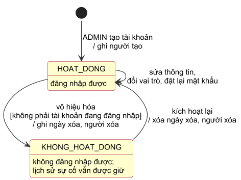

*Hình 3.14. Sơ đồ trạng thái của tài khoản NguoiDung.*

Đây là cách hiện thực giả định G5 ("xóa" người dùng nghĩa là vô hiệu hóa). Điều kiện
`[không phải tài khoản đang đăng nhập]` ứng với test T10. Tình trạng `ThietBi` (HOẠT_ĐỘNG/HỎNG/ĐANG_SỬA) chỉ do
cán bộ CNTT sửa tay, không có sự kiện hay quy tắc tự động nào, nên không cần vẽ sơ đồ trạng thái cho nó.

### 3.5. Giải thích quyết định thiết kế theo GRASP/SOLID

| Nguyên tắc | Áp dụng ở đâu | Giải thích |
|---|---|---|
| **Information Expert** | `SuCo.daHoanThanh()`; `SuCoRepo` là nơi duy nhất viết SQL cho bảng `SU_CO`. | `SuCo` tự biết trạng thái của chính nó nên tự trả lời được câu hỏi "đã xong chưa" thay vì Controller phải so sánh chuỗi `"HOAN_THANH"` rải rác nhiều nơi; `SuCoRepo` nắm cấu trúc bảng/view nên là nơi hợp lý nhất để đọc/ghi dữ liệu sự cố. |
| **Creator** | `AdminController.capNhat` quyết định **thời điểm** cần tạo `BaiKinhNghiem` mới (khi `luuKho=true`), nhưng giao việc tạo thật sự cho `KinhNghiemRepo.taoMoi`. | Controller biết ngữ cảnh nghiệp vụ (đang xử lý sự cố nào, admin nào) nên hợp lý để quyết định *khi nào* tạo, còn `KinhNghiemRepo` nắm cấu trúc bảng `BAI_KINH_NGHIEM` nên là nơi hợp lý để *thực hiện* việc tạo. |
| **Controller (GRASP)** | `SuCoController`, `AdminController`, `AuthController`. | Mỗi controller tiếp nhận request của đúng một nhóm UC liên quan (báo/theo dõi sự cố, xử lý sự cố của admin, đăng nhập) thay vì dùng 1 controller khổng lồ xử lý mọi request — tương ứng nguyên tắc chọn Controller theo "use-case controller". |
| **Polymorphism + OCP** | `BoLuuTru` (abstract, Template Method `luu()`) với 2 lớp con `LuuAnhSuCo`/`LuuTepTraoDoi`. | Phần lưu file xuống đĩa và sinh tên file là *chung*, chỉ khác ở danh sách loại file được phép và thông báo lỗi. Muốn thêm một loại lưu trữ mới (ví dụ file đính kèm cho bài kinh nghiệm) chỉ cần thêm 1 lớp con mới kế thừa `BoLuuTru`, **không sửa** `luu()` đã có — đúng tinh thần Open/Closed. |
| **Polymorphism + ISP** | Interface `CoNhan` (`getNhan()`, `getLopBadge()`) do 5 enum (`VaiTro`, `TrangThaiNguoiDung`, `TrangThaiSuCo`, `MucUuTien`, `TinhTrangThietBi`) cùng implement. | Giao diện Thymeleaf chỉ cần gọi `t.nhan`/`t.lopBadge` để hiển thị badge mà không cần biết đang cầm enum cụ thể nào — interface chỉ có đúng 2 phương thức cần dùng, không ép các enum phải cài thêm hành vi không liên quan. |
| **LSP** | `LuuAnhSuCo`/`LuuTepTraoDoi` dùng thay cho nhau tại chỗ gọi `BoLuuTru.luu(file)`. | Cả hai đều tuân thủ đúng hợp đồng của lớp cha: trả về URL hợp lệ hoặc ném `FileKhongHopLeException`/`IOException`, không có hành vi bất ngờ nào phá vỡ kỳ vọng của nơi gọi. |
| **Pure Fabrication + SRP** | `AuthInterceptor` (xác thực/phân quyền), `XuLyLoiChung` (`@ControllerAdvice` xử lý lỗi tập trung). | Hai mối quan tâm "ai được vào trang nào" và "lỗi dữ liệu/lỗi upload hiển thị thế nào" không gắn liền với một khái niệm nghiệp vụ cụ thể nào (không phải trách nhiệm tự nhiên của `SuCo` hay `NguoiDung`) — tách thành 2 lớp phụ trợ riêng để mọi Controller dùng chung, tránh lặp lại try-catch ở từng nơi. |
| **High Cohesion / Low Coupling** | Mỗi `*Repo` chỉ thao tác đúng 1 bảng/nhóm bảng liên quan trực tiếp của nó; `SuCoRepo` đọc từ `V_SU_CO_CHI_TIET` (view đã JOIN sẵn) thay vì tự JOIN 5 bảng ở tầng Java. | Gom việc JOIN xuống CSDL (nơi làm việc đó hiệu quả nhất) giữ cho `SuCoRepo` tập trung vào đúng một việc (đọc/ghi sự cố), giảm phụ thuộc chéo giữa các Repo. |
| **DIP — giới hạn đã biết** | Controller phụ thuộc trực tiếp vào lớp `*Repo` cụ thể (không qua interface). | Đây là đánh đổi có chủ đích cho quy mô đồ án (không cần 2 cách triển khai lưu trữ khác nhau nên interface sẽ thừa — tránh "nhiều interface cũng không tự động làm thiết kế tốt hơn" như hướng dẫn BTL đã lưu ý), nhưng nhóm cần nêu rõ đây là giới hạn khi bảo vệ, không che giấu. |

### 3.6. Thiết kế dữ liệu (ERD)

Sơ đồ ER đầy đủ 9 bảng ở Hình 3.15; bảng mô tả khóa chính/khóa ngoại và các ràng buộc chi tiết xem
[SO_DO_QUAN_HE.md](SO_DO_QUAN_HE.md). Ký hiệu chân chim: `||` đúng một, `|o` không hoặc một, `o{` không hoặc
nhiều; dấu chấm trước tên cột là cột `NOT NULL`.

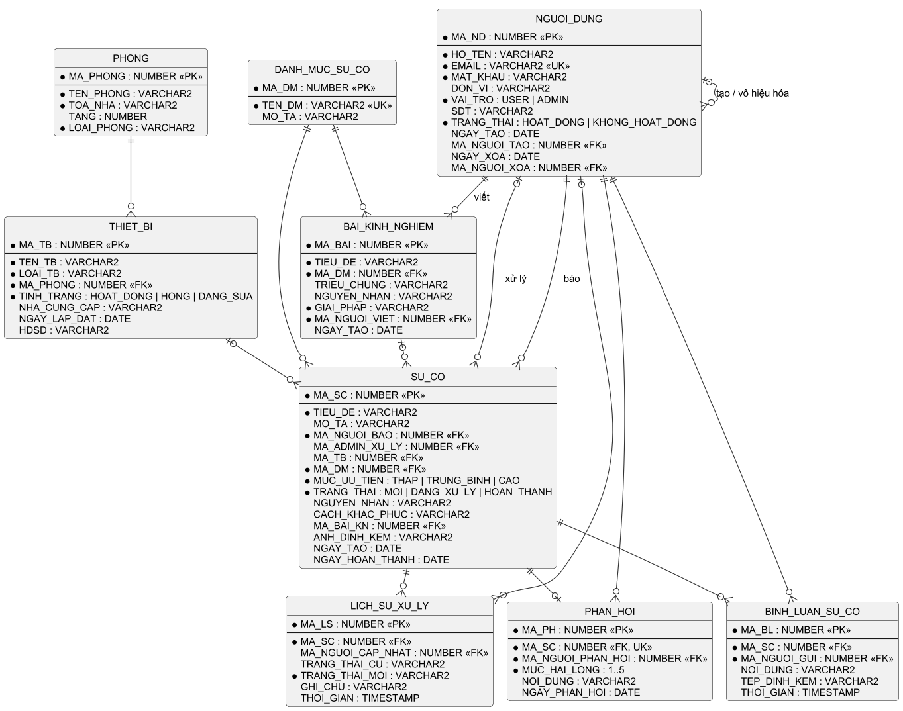

*Hình 3.15. Sơ đồ thực thể – liên kết (ERD) của CSDL Oracle.*

Phần dưới chỉ nêu các điểm **ánh xạ không phải 1-1** từ mô hình khái niệm (§2.2) sang thiết kế dữ liệu, đúng
tinh thần Mục 4.6 của hướng dẫn BTL:

- **`LanXuLy` → bảng `LICH_SU_XU_LY`, nhưng không có "LichSuController"/Repo nào ghi trực tiếp.** Đối
  tượng này được **CSDL tự sinh ra** (trigger `TRG_SU_CO_LICH_SU`), không phải tầng Java tạo — một ví dụ rõ
  cho việc "không phải mọi lớp phân tích đều cần một lớp Java tương ứng ở tầng cài đặt": trách nhiệm ghi
  lịch sử được đẩy xuống tầng CSDL vì nó phải đúng **mọi lúc** cột `TRANG_THAI` đổi, kể cả khi có ai đó sửa
  dữ liệu trực tiếp bằng SQL, không chỉ qua ứng dụng.
- **`SuCoHayGap` (model Java `vn.utc.suco.model.SuCoHayGap`) không map tới bảng nào** — nó map tới view
  `V_SU_CO_THUONG_GAP`, dữ liệu suy ra bằng `COUNT(...)` tại thời điểm truy vấn chứ không lưu cứng, để tránh
  phải tự đồng bộ một cột tần suất mỗi khi có sự cố mới (đúng khuyến cáo "không phải mọi lớp cần trở thành
  bảng").
- **Quan hệ phản thân của `NguoiDung`** (`MA_NGUOI_TAO`, `MA_NGUOI_XOA` — ai tạo/ai vô hiệu hóa tài khoản
  này) không xuất hiện trong mô hình khái niệm ở §2.2 vì đây là chi tiết vận hành/kiểm toán (audit), không
  phải khái niệm nghiệp vụ cốt lõi mà người dùng cuối quan tâm — chỉ được thêm vào ở mức thiết kế dữ liệu.
- **Bội số `0..1`/`1` ở mô hình khái niệm được hiện thực bằng ràng buộc `NOT NULL`/cho phép `NULL`** ở cột
  khóa ngoại tương ứng (ví dụ `SU_CO.MA_TB` cho phép NULL vì quan hệ ThietBi–SuCo là `0..1`), và bội số
  `0..1` "chỉ 1 bản ghi con" (như `SuCo`–`PhanHoi`) được hiện thực bằng ràng buộc `UNIQUE` trên khóa ngoại
  (`UQ_PHAN_HOI_SU_CO`) thay vì chỉ dựa vào quy ước ở tầng ứng dụng.

---

## CHƯƠNG 4. CÀI ĐẶT VÀ KIỂM THỬ

### 4.1. Cấu trúc dự án và công nghệ

Xem chi tiết đầy đủ ở [README.md](README.md) (môi trường, cách dựng CSDL, cách chạy). Tóm tắt:

- Spring Boot 4.1.1 (Spring MVC + Thymeleaf + JdbcTemplate), Java 21, Oracle Database (PDB `FREEPDB1`).
- `sql/` chứa toàn bộ script CSDL chạy một mạch bằng `@00_run_all.sql` (tablespace, 9 bảng, trigger, dữ
  liệu demo, 2 view).
- `src/main/java/vn/utc/suco/{model,repository,controller,config,util}` — đúng cấu trúc BCE đã mô tả ở
  §3.1.

### 4.2. Minh chứng cài đặt gắn với Use Case

| Use Case | Route | Controller | Template |
|---|---|---|---|
| UC1 Đăng nhập/Đăng xuất | `GET/POST /login`, `GET /logout` | `AuthController` | `login.html` |
| UC2 Báo sự cố | `POST /user/bao-cao` | `SuCoController.baoSuCo` | `user.html` |
| UC3 Theo dõi sự cố của tôi | `GET /user`, `GET /user/{maSc}` | `SuCoController` | `user.html`, `user-chi-tiet.html` |
| UC4 Trao đổi về sự cố | `POST /user/{maSc}/binh-luan`, `POST /admin/{maSc}/binh-luan` | `SuCoController`, `AdminController` | `user-chi-tiet.html`, `admin-chi-tiet.html` |
| UC5 Gửi phản hồi | `POST /user/{maSc}/phan-hoi` | `SuCoController.guiPhanHoi` | `user-chi-tiet.html` |
| UC6 Xử lý sự cố | `GET /admin`, `POST /admin/{maSc}` | `AdminController` | `admin.html`, `admin-chi-tiet.html` |
| UC7 Lưu kinh nghiệm xử lý | `POST /admin/{maSc}` (tham số `luuKho`) | `AdminController.capNhat` → `KinhNghiemRepo` | `admin-chi-tiet.html` |
| UC8 Tra cứu kho kinh nghiệm | `GET /kinh-nghiem`, `GET /kinh-nghiem/{maBai}` | `KinhNghiemController` | `kinh-nghiem.html`, `kinh-nghiem-chi-tiet.html` |
| UC9 Quản lý kho kinh nghiệm | `/admin/kinh-nghiem/**` | `KinhNghiemController` | `kinh-nghiem-quan-ly.html`, `kinh-nghiem-sua.html` |
| UC10 Quản lý danh mục | `/admin/danh-muc/**` | `DanhMucController` | `danh-muc.html`, `danh-muc-sua.html` |
| UC11 Quản lý phòng | `/admin/phong/**` | `PhongController` | `phong.html`, `phong-sua.html` |
| UC12 Quản lý thiết bị | `/admin/thiet-bi/**` | `ThietBiController` | `thiet-bi.html`, `thiet-bi-sua.html` |
| UC13 Nhập thiết bị từ Excel | `POST /admin/thiet-bi/nhap-excel` | `ThietBiController` | `thiet-bi.html` |
| UC14 Quản lý người dùng | `/admin/nguoi-dung/**` | `NguoiDungController` | `nguoi-dung.html`, `nguoi-dung-sua.html` |
| UC15 Xem thống kê | `GET /admin/thong-ke` | `ThongKeController` | `thong-ke.html` |
| UC16 Xuất Excel | `GET /admin/xuat-excel` | `AdminController.xuatExcel` | *(tải file trực tiếp)* |

### 4.3. Kế hoạch test case

Bảng dưới là **kế hoạch** test case theo luồng chính và ngoại lệ đã đặc tả ở §1.7 — nhóm cần tự chạy ứng
dụng (theo README.md), điền cột "Kết quả thực tế" và ảnh chụp minh họa, không được để trống khi nộp (đúng
yêu cầu "không chỉ chụp giao diện; cần chứng minh quy tắc nghiệp vụ quan trọng hoạt động đúng").

| # | UC | Input | Điều kiện | Kết quả mong đợi | Kết quả thực tế |
|---|---|---|---|---|---|
| T1 | UC2 | Báo sự cố, bỏ trống tiêu đề | Luồng ngoại lệ 2a | Báo lỗi, không tạo sự cố mới | *(điền khi test)* |
| T2 | UC2 | Báo sự cố, đính kèm file `.pdf` làm ảnh | Luồng ngoại lệ 3a | Báo lỗi "Chỉ nhận ảnh JPG, PNG, GIF hoặc WEBP" | *(điền khi test)* |
| T3 | UC2 | Báo sự cố hợp lệ, đủ trường | Luồng chính | Sự cố mới xuất hiện ở `/admin` với trạng thái `MỚI` | *(điền khi test)* |
| T4 | UC6 | Đổi trạng thái `MỚI → ĐANG_XỬ_LÝ` | Luồng chính | Có thêm 1 dòng lịch sử; `NGAY_HOAN_THANH` vẫn `NULL` | *(điền khi test)* |
| T5 | UC6/UC7 | Đổi trạng thái sang `HOÀN_THÀNH`, tick "lưu vào kho" nhưng bỏ trống nguyên nhân | Luồng ngoại lệ 2b | Báo lỗi, không lưu cập nhật, không tạo bài kinh nghiệm | *(điền khi test)* |
| T6 | UC6/UC7 | Đổi trạng thái sang `HOÀN_THÀNH`, tick "lưu vào kho", điền đủ nguyên nhân/cách khắc phục/danh mục | Luồng thay thế 2a | `NGAY_HOAN_THANH` được gán tự động; có bài kinh nghiệm mới trong `/kinh-nghiem`; sự cố gắn với bài đó | *(điền khi test)* |
| T7 | UC5 | Gửi phản hồi khi sự cố còn `ĐANG_XỬ_LÝ` | Luồng ngoại lệ 1a | Báo lỗi "Chỉ gửi phản hồi được khi sự cố đã hoàn thành" | *(điền khi test)* |
| T8 | UC5 | Gửi phản hồi lần 2 cho cùng 1 sự cố đã `HOÀN_THÀNH` | Luồng ngoại lệ 2a | Báo lỗi "Sự cố này đã được phản hồi rồi", không tạo bản ghi trùng | *(điền khi test)* |
| T9 | UC11 | Thêm phòng trùng tên (cùng tòa, cùng tầng) | Quy tắc R6 | Báo lỗi trùng, không thêm | *(điền khi test)* |
| T10 | UC14 | Admin tự vô hiệu hóa chính tài khoản mình | Ràng buộc tự bảo vệ | Hệ thống từ chối thao tác | *(điền khi test)* |

### 4.4. Giới hạn sản phẩm

- Vòng đời trạng thái sự cố chưa bị ép buộc đi đúng thứ tự ở tầng ứng dụng (xem §2.6, §3.4) — có thể bổ
  sung guard nếu muốn chặt chẽ hơn.
- Chưa có thông báo chủ động (email/SMS) khi sự cố đổi trạng thái — người dùng phải tự vào xem.
- Một sự cố chỉ gắn được tối đa 1 thiết bị; chưa hỗ trợ sự cố liên quan nhiều thiết bị cùng lúc.
- Controller phụ thuộc trực tiếp lớp `Repo` cụ thể, không qua interface (xem đánh đổi DIP ở §3.5).

---

## KẾT LUẬN

Hệ thống đáp ứng được mục tiêu đặt ra ở §1.1: hỗ trợ đầy đủ quy trình báo cáo → xử lý → phản hồi → tích lũy
kinh nghiệm cho sự cố CNTT, có đủ các quy tắc nghiệp vụ và trường hợp ngoại lệ để phân tích sâu (không chỉ
là CRUD đơn thuần) — thể hiện qua các quyết định thiết kế đã giải thích ở Chương 3 (đặc biệt là Information
Expert ở `SuCoRepo`/`SuCo`, Polymorphism+OCP ở `BoLuuTru`, và việc đẩy một phần trách nhiệm toàn vẹn dữ liệu
xuống CSDL qua trigger). Giới hạn còn lại (nêu ở §4.4) là các hướng cải tiến khả thi cho các phiên bản sau,
không ảnh hưởng tới luồng nghiệp vụ chính.

*(Nhóm bổ sung thêm nhận xét riêng của nhóm về mức độ đáp ứng và những gì đã học được qua bài tập lớn này.)*

## TÀI LIỆU THAM KHẢO

1. Tài liệu "Hướng dẫn thực hiện Bài tập lớn — Học phần Phân tích và thiết kế hướng đối tượng (OOAD)".
2. Larman, C. — *Applying UML and Patterns* (nguồn gốc các nguyên tắc GRASP).
3. Mã nguồn và tài liệu nội bộ của chính dự án: [README.md](README.md), [SO_DO_QUAN_HE.md](SO_DO_QUAN_HE.md), `sql/`.

## PHỤ LỤC

### Bảng phân công và đóng góp

| Họ tên | MSSV | Nhiệm vụ phụ trách | % đóng góp |
|---|---|---|---|
| *(điền)* | *(điền)* | *(điền — ví dụ: Chương 1 + UC Diagram)* | *(điền)* |
| *(điền)* | *(điền)* | *(điền — ví dụ: Chương 2 + Conceptual Model/CRC)* | *(điền)* |
| *(điền)* | *(điền)* | *(điền — ví dụ: Chương 3 + Sequence/DCD/State Machine)* | *(điền)* |
| *(điền)* | *(điền)* | *(điền — ví dụ: Chương 4 + kiểm thử)* | *(điền)* |

### Mã nguồn các sơ đồ UML

Toàn bộ 26 hình trong báo cáo được vẽ bằng PlantUML. Mã nguồn nằm ở `docs/uml/src/*.puml` (kiểu dáng dùng chung ở `docs/uml/src/_style.iuml`), ảnh PNG đã xuất nằm ở `docs/uml/`. Tên file khớp với số hình, ví dụ `h3_2b_sd_uc6_uc7.puml` là Hình 3.4.

Khi sửa một sơ đồ, xuất lại ảnh bằng lệnh sau (cần Java và `plantuml.jar` tải từ https://plantuml.com/download, không cần Graphviz):

```sh
sh docs/uml/render.sh /duong/dan/plantuml.jar
```
