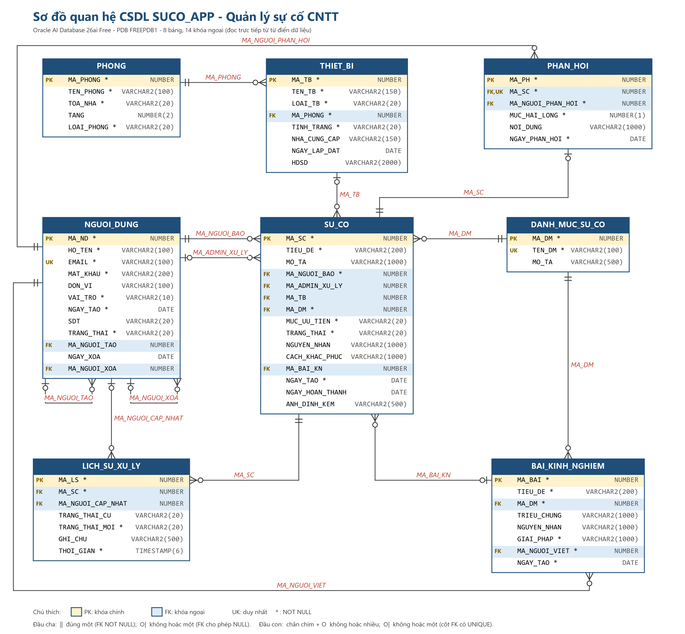
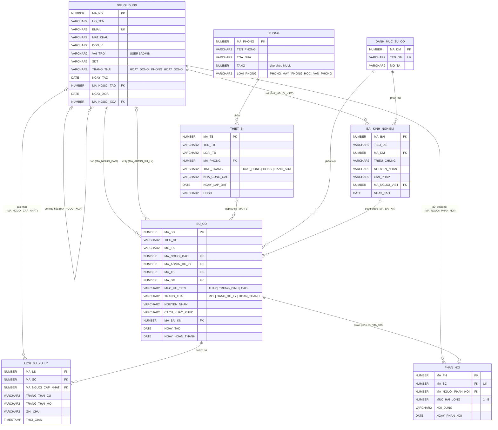

# Sơ đồ quan hệ CSDL - Hệ thống quản lý sự cố CNTT

Schema `SUCO_APP`, tablespace `TS_SUCO`.

## Sơ đồ ER (ảnh, đọc trực tiếp từ CSDL Oracle)



File ảnh: `docs/so_do_ER_SUCO_APP.png` (2892 x 2678 px, chèn vào Word nên để trang nằm ngang hoặc để ảnh chiếm cả chiều rộng trang). Ảnh được vẽ bằng `tools/VeSoDoER.java`: chương trình đọc bảng, cột, kiểu dữ liệu, khóa chính, khóa ngoại, ràng buộc duy nhất và NOT NULL từ từ điển dữ liệu Oracle (`user_tab_columns`, `user_constraints`, `user_cons_columns`).

**Cập nhật 10/10/2026:** ảnh đã vẽ lại, **đủ 8 bảng và 14 khóa ngoại**, khớp với sơ đồ Mermaid bên dưới. `VeSoDoER.java` đã được sửa: thêm ô lưới cho `PHAN_HOI` (góc trên bên phải, nối với `SU_CO` qua hành lang giữa hàng 0 - hàng 1 và với `NGUOI_DUNG` qua hành lang phía trên), vẽ 2 khóa ngoại tự tham chiếu của `NGUOI_DUNG` thành hai vòng nhỏ dưới đáy bảng, và phân biệt quan hệ 1-1: cột khóa ngoại có UNIQUE (`PHAN_HOI.MA_SC`) được vẽ đầu con là `O|` (không hoặc một) thay vì chân chim.

Lưu ý khi sửa cấu trúc bảng về sau: bố cục trong `VeSoDoER.java` vẫn là **viết tay** (lưới 3x3 cố định + mỗi khóa ngoại một nhánh `if` riêng chỉ ra đường đi). Thêm bảng hoặc khóa ngoại mới thì phải thêm ô lưới và nhánh vẽ tương ứng, nếu không chương trình in `CANH BAO: chua co duong noi cho ...` và bỏ qua đường đó.

Vẽ lại sau khi sửa cấu trúc bảng:

```
java -cp <đường_dẫn>\ojdbc17-23.26.3.0.0.jar tools\VeSoDoER.java
```

(tham số tùy chọn: url, user, mật khẩu, tên file PNG; mặc định `SUCO_APP` trên `FREEPDB1`).

Ký hiệu: `PK` khóa chính (nền vàng), `FK` khóa ngoại (nền xanh), `UK` duy nhất, `*` NOT NULL. Đầu cha: `||` đúng một (FK NOT NULL), vòng tròn + thanh là không hoặc một (FK cho phép NULL). Đầu con: chân chim + vòng tròn là không hoặc nhiều.

## Sơ đồ Mermaid (bản văn bản)

Có thể dán khối Mermaid bên dưới vào bất kỳ công cụ nào hỗ trợ Mermaid (GitHub, VS Code, mermaid.live) để xuất hình khác.



## Mô tả các bảng

| Bảng | Vai trò | Khóa ngoại |
|---|---|---|
| NGUOI_DUNG | Sinh viên, giảng viên, cán bộ và admin (bộ phận IT) | MA_NGUOI_TAO, MA_NGUOI_XOA -> NGUOI_DUNG (tự tham chiếu) |
| PHONG | Phòng máy, phòng học, văn phòng theo tòa nhà và tầng | - |
| THIET_BI | Thiết bị đặt trong phòng | MA_PHONG -> PHONG |
| DANH_MUC_SU_CO | Danh mục dùng chung cho sự cố và bài kinh nghiệm | - |
| BAI_KINH_NGHIEM | Kho kinh nghiệm xử lý theo danh mục | MA_DM -> DANH_MUC_SU_CO; MA_NGUOI_VIET -> NGUOI_DUNG |
| SU_CO | Sự cố do người dùng báo, admin xử lý | MA_NGUOI_BAO, MA_ADMIN_XU_LY -> NGUOI_DUNG; MA_TB -> THIET_BI; MA_DM -> DANH_MUC_SU_CO; MA_BAI_KN -> BAI_KINH_NGHIEM |
| LICH_SU_XU_LY | Nhật ký đổi trạng thái, do trigger ghi | MA_SC -> SU_CO; MA_NGUOI_CAP_NHAT -> NGUOI_DUNG |
| PHAN_HOI | Phản hồi của người báo sau khi sự cố HOAN_THANH (đánh giá 1-5) | MA_SC -> SU_CO (UNIQUE: mỗi sự cố 1 phản hồi); MA_NGUOI_PHAN_HOI -> NGUOI_DUNG |

## Ràng buộc và đối tượng đi kèm

- **Cột cho phép NULL trong SU_CO:** `MA_ADMIN_XU_LY` (chưa có admin nhận), `MA_TB` (sự cố không gắn thiết bị, ví dụ quên mật khẩu), `MA_BAI_KN`, `NGUYEN_NHAN`, `CACH_KHAC_PHUC`, `NGAY_HOAN_THANH`.
- **Xóa mềm NGUOI_DUNG:** không có DELETE, web chỉ chuyển `TRANG_THAI` sang `KHONG_HOAT_DONG` và ghi `NGAY_XOA`/`MA_NGUOI_XOA`; tài khoản không hoạt động không đăng nhập được (lọc ở `NguoiDungRepo.dangNhap`) nhưng dữ liệu cũ (sự cố, bài kinh nghiệm, lịch sử) vẫn giữ nguyên.
- **PHONG.TANG cho phép NULL:** một số văn phòng chỉ có 1 tầng nên không cần ghi số tầng.
- **CHECK:** `CK_SU_CO_NGAY_HT` bảo đảm `NGAY_HOAN_THANH >= NGAY_TAO`; `CK_PHAN_HOI_MUC` giới hạn `MUC_HAI_LONG` từ 1-5; các CHECK khác giới hạn giá trị vai trò, trạng thái người dùng, loại phòng, loại và tình trạng thiết bị, mức ưu tiên, trạng thái sự cố.
- **Trigger:** `TRG_SU_CO_LICH_SU` ghi `LICH_SU_XU_LY` khi `TRANG_THAI` đổi; `TRG_SU_CO_HOAN_THANH` tự gán `NGAY_HOAN_THANH`.
- **View:** `V_SU_CO_CHI_TIET` ghép SU_CO với người báo, admin, thiết bị, phòng, danh mục; `V_SU_CO_THUONG_GAP` đếm số sự cố theo danh mục (phục vụ mục "sự cố hay gặp" ở trang người dùng) — tính bằng truy vấn thay vì lưu cột tần suất tĩnh để khỏi lệch dữ liệu; web đọc từ 2 view này.
