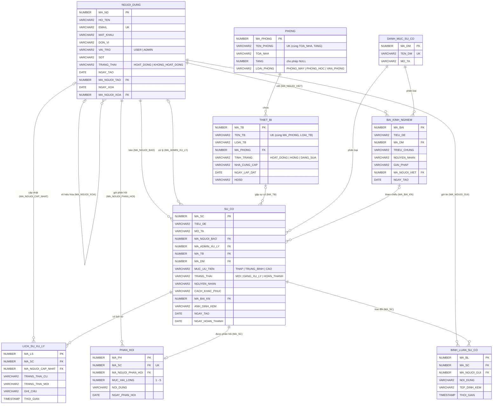

# Sơ đồ quan hệ CSDL - Hệ thống quản lý sự cố CNTT

Schema `SUCO_APP`, tablespace `TS_SUCO`, 9 bảng. Có thể dán khối Mermaid dưới đây vào bất kỳ công cụ nào hỗ
trợ Mermaid (GitHub, VS Code, mermaid.live) để xem hình.

## Mô tả các bảng

| Bảng | Vai trò | Khóa ngoại |
|---|---|---|
| NGUOI_DUNG | Sinh viên, giảng viên, cán bộ và admin (bộ phận IT) | MA_NGUOI_TAO, MA_NGUOI_XOA -> NGUOI_DUNG (tự tham chiếu) |
| PHONG | Phòng máy, phòng học, văn phòng theo tòa nhà và tầng | - |
| THIET_BI | Thiết bị đặt trong phòng | MA_PHONG -> PHONG |
| DANH_MUC_SU_CO | Danh mục dùng chung cho sự cố và bài kinh nghiệm | - |
| BAI_KINH_NGHIEM | Kho kinh nghiệm xử lý theo danh mục | MA_DM -> DANH_MUC_SU_CO; MA_NGUOI_VIET -> NGUOI_DUNG |
| SU_CO | Bảng trung tâm: sự cố do người dùng báo, admin xử lý | MA_NGUOI_BAO, MA_ADMIN_XU_LY -> NGUOI_DUNG; MA_TB -> THIET_BI; MA_DM -> DANH_MUC_SU_CO; MA_BAI_KN -> BAI_KINH_NGHIEM |
| LICH_SU_XU_LY | Nhật ký đổi trạng thái, do trigger ghi | MA_SC -> SU_CO; MA_NGUOI_CAP_NHAT -> NGUOI_DUNG |
| PHAN_HOI | Phản hồi 1-5 sao của người báo sau khi sự cố HOAN_THANH | MA_SC -> SU_CO (UNIQUE: mỗi sự cố 1 phản hồi); MA_NGUOI_PHAN_HOI -> NGUOI_DUNG |
| BINH_LUAN_SU_CO | Trao đổi qua lại (không giới hạn số lần) giữa người báo và admin trên một sự cố | MA_SC -> SU_CO; MA_NGUOI_GUI -> NGUOI_DUNG |

## Ràng buộc và đối tượng đi kèm

- **Cột cho phép NULL trong SU_CO:** `MA_ADMIN_XU_LY` (chưa có admin nhận), `MA_TB` (sự cố không gắn thiết bị, ví dụ quên mật khẩu), `MA_BAI_KN`, `NGUYEN_NHAN`, `CACH_KHAC_PHUC`, `ANH_DINH_KEM`, `NGAY_HOAN_THANH`.
- **Xóa mềm NGUOI_DUNG:** không có DELETE, web chỉ chuyển `TRANG_THAI` sang `KHONG_HOAT_DONG` và ghi `NGAY_XOA`/`MA_NGUOI_XOA`; tài khoản không hoạt động không đăng nhập được, dữ liệu cũ (sự cố, bài kinh nghiệm, lịch sử) vẫn giữ nguyên.
- **PHONG.TANG cho phép NULL:** một số văn phòng chỉ có 1 tầng nên không cần ghi số tầng.
- **Chống trùng tên ở tầng CSDL:** `UQ_PHONG_TEN` (cùng tòa, tầng, tên) và `UQ_THIET_BI_TEN` (cùng phòng, loại, tên) là function-based unique index, không phân biệt hoa thường; web cũng tự kiểm tra trùng trước khi lưu, index chỉ là lớp bảo vệ cuối.
- **CHECK:** `CK_SU_CO_NGAY_HT` bảo đảm `NGAY_HOAN_THANH >= NGAY_TAO`; `CK_PHAN_HOI_MUC` giới hạn `MUC_HAI_LONG` từ 1-5; các CHECK khác giới hạn giá trị vai trò, trạng thái người dùng, loại phòng, loại và tình trạng thiết bị, mức ưu tiên, trạng thái sự cố.
- **Trigger:** `TRG_SU_CO_LICH_SU` ghi `LICH_SU_XU_LY` khi `TRANG_THAI` đổi; `TRG_SU_CO_HOAN_THANH` tự gán `NGAY_HOAN_THANH`.
- **View:** `V_SU_CO_CHI_TIET` ghép SU_CO với người báo, admin, thiết bị, phòng, danh mục; `V_SU_CO_THUONG_GAP` đếm số sự cố theo danh mục (phục vụ mục "sự cố hay gặp" ở trang người dùng) — tính bằng truy vấn thay vì lưu cột tần suất tĩnh để khỏi lệch dữ liệu; web đọc từ 2 view này (`sql/05_views.sql`).
